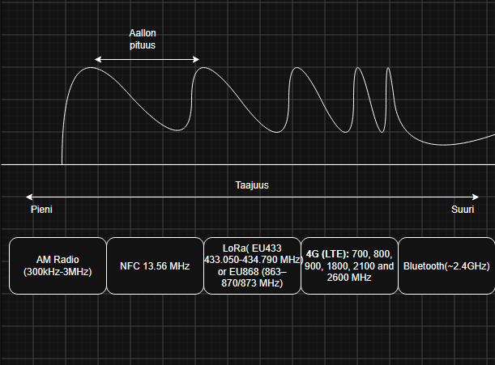
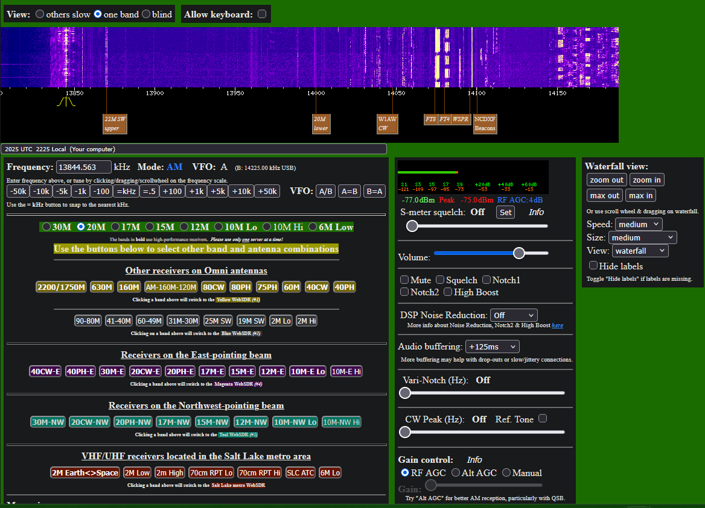
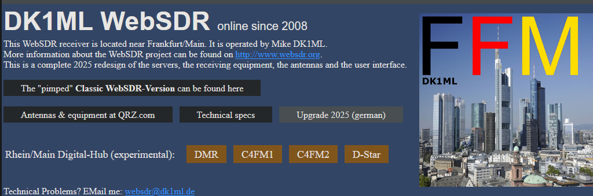
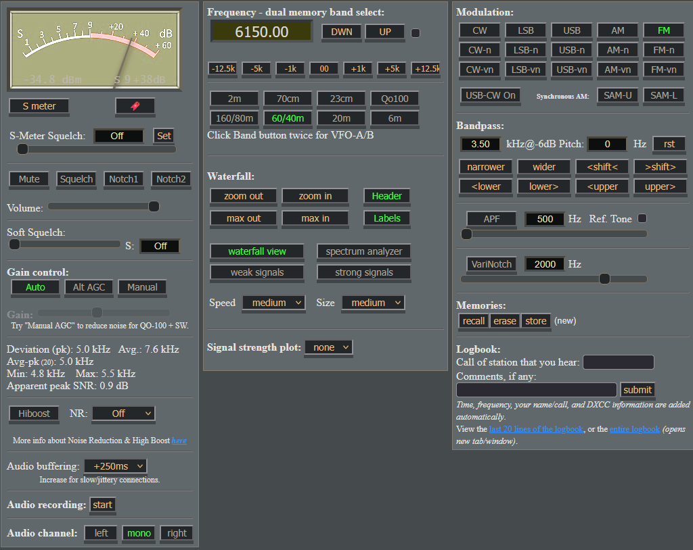
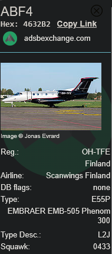
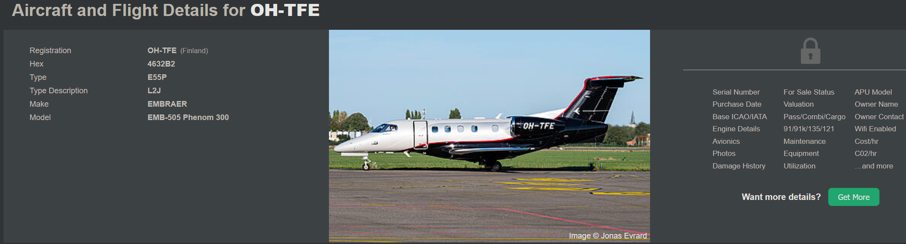

# h1 Korva Netissä
### x) Spektrini
  
* Taajuus ja aallonpituus ovat kääntäen verrannolliset, eli kun toinen kasvaa niin toinen pienenee.
* Korkealla taajuudella voi siirtää enemmän tietoa.
* Yleensä matalampi taajuus läpäisee jaa kiertää esteitä paremmin, mutta tähän löytyy poikkeuksia (röntgen) (gamma)
### a) WebSDR
Avasin websdr sivuston selaimeen ja etsin sieltä mieleisen webSDR:n.
   
Päädyin valitsemaan Northern Utah WebSDR - Server #2
   
Valitsin vesiputousmallista taajuuden 13844 kohdalta, sillä siellä näyttää olevan jatkuvaa lähetystä.
Modulaatio on AM
   
Lähetys kuullosti yleiseltä radio lähetykseltä.

### b) Moduwhat?
Toiseen tehtävään vaihdoin websdr:ää
  
Asetukset
  
En oikein osaa sanoa lähetyksen sisällöstä, sillä se on vieraskielistä, mutta lähetys kuului modulaatiolla FM

### c) ADS-B
Tässä tehtävässä avasin adsbexchaange nimisen sivuston, josta voi tarkastella livenä lentoja. Valitsin pienen hetken tutkailtuani Scanwings Finland airlinen ABF4 lentokoneen.
  
Kaikki lennon tiedot eivät olleet tästä palvelusta saatavilla maksutta, mutta tässä ne mitä oli saatavilla:
* Registration OH-TFE(Finland)
* Hex 4632B2
* Type E55P
* Type Description L2J
* Make EMBRAER
* Model EMB-505 Phenom 300

  

## Lähteet:
http://websdr2.sdrutah.org:8902/index1a.html - websdr Northern Utah

http://sdr.homeip.net:8901/ - websdr DK1ML

https://globe.adsbexchange.com/?icao=4632b2 - adsb sivusto lentojen seuraamiseen