# h2

### x) Lue ja tiivistä
* WireShark: työkalu jolla voidaan napata verkkoliikennettä ja analysoidaa sitä.
* Network interface prefix kertoo minkä tyyppisestä yhteydestä on kyse:

| Prefix | Interface type |
| ------ | ------------------------------ |
| en     | Wired **E**ther**n**et |
| wl     | **WL**AN, wireless local area network, WiFi |
| lo     | **Lo**opback adapter |

| Interface | Explanation          |
| --------- | -------------------- |
| wlp4s0    | WiFi card.           |
| enp1s0    | Wired ethernet card. |
| lo        | Loopback adapter.    |

### b) Nettiyhteys poikki
Tarkistin "ip a" komennolla kaikki verkkoliitännät ja niiden tiedot.
 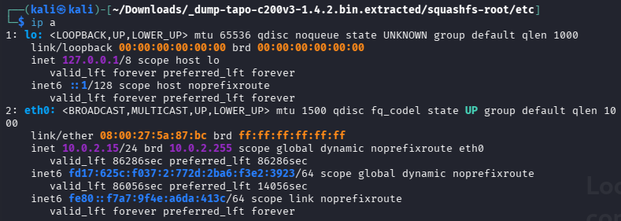 
Ja sitten suljin eth0 liitännän.
 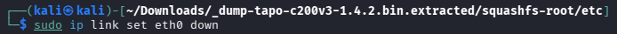 
Tässä vielä varmistus:
 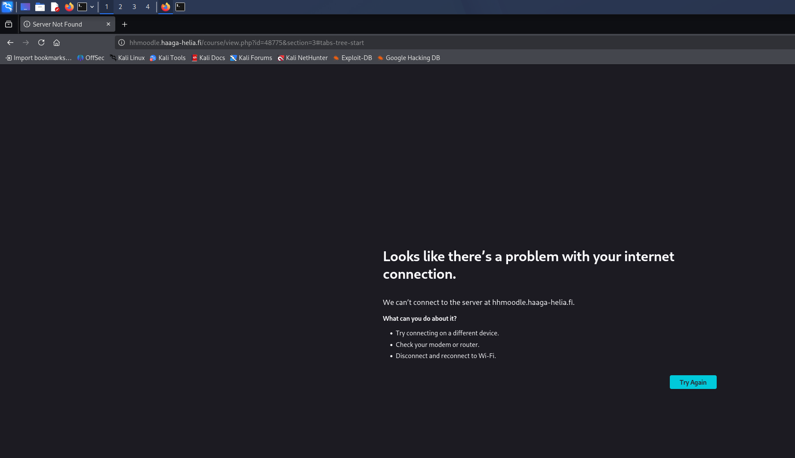 

### c) Wireshark
Wireshark on valmiiksi asennettuna Kali VM:ssä, mutta sen saisi asennettua myös esimerkiksi "sudo apt install wireshark" komennolla.

Avasin wiresharkin ja valitsin etusivulta eth0:
 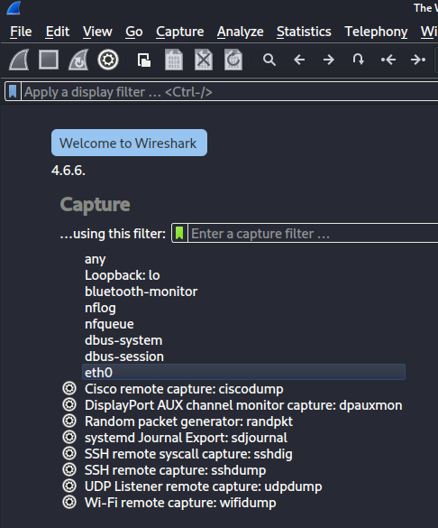 

Kytkettyäni eth0 liitännän takaisin päälle näytti liikenne tältä:
 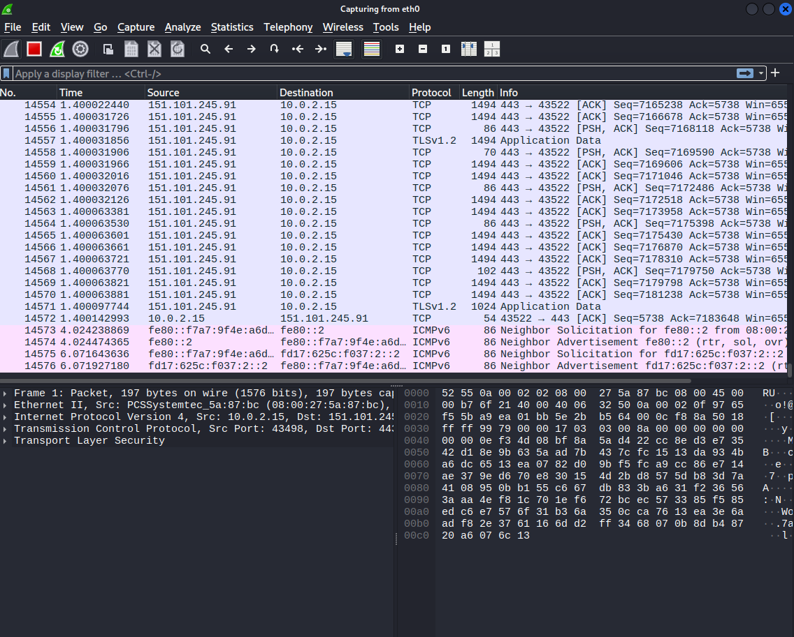 

### d) TCP/IP

Generoin liikennettä avaamalla googlen selaimeen. Avaamalla sieltä ensimmäisen paketin tiedot tarkasteltavaksi se näyttää tältä:
 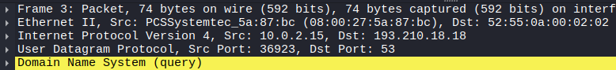 
Tässä näkyvät TCP/IP-mallin 4 kerrosta eli Application, Transport, Internet ja Data Link.
Tasot menevät järjestyksessä alhaalta ylös:
| TCP/IP Layer | Wireshark Protocol |
|---|---|
| Application Layer | Domain Name System (query) |
| Transport Layer | User Datagram Protocol (UDP) |
| Internet Layer | Internet Protocol Version 4 (IPv4) |
| Network Access Layer | Ethernet II |

### e) Surfing-secure.pcap
Latasin tiedoston terokarvinen.com sivulta, avasin sen wiresharkissa ja aloitin sen tutkimisen. Ylhäältä wiresharkin toolbaarista löytyy statistic jonka alta löytyi endpoints. Täältä näkee esimerkiksi internet protokolleissa olleet IP-osoitteet. (IPv4 osoitteita on 7)
 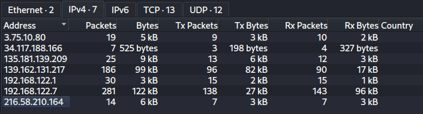 
Protokollia olivat TCP, QUIC, DNS, ARP ja TLSv1.3
 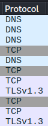 
Kaappauksen kokonais kesto oli noin 7.5 sekuntia ja siinä napattiin 283 pakettia.

### g) Verkkokortti
Tässä tehtävässä en tiennyt miten lähteä etenemään, joten kysyin GPT-6 apua.

GPT-6 mukaan paketista voi nähdä MAC osoitteen ja sen kolmen ensimmäisen tavun avulla, jotka muodostavat OUI-tunnisteen voidaan etsiä valmistaja.

Etsin MAC osoitteen:
  

GPT-6 mukaan on todennäköistä että tämä verkkokortti on virtualisoitu. Ilmeisesti 52:54:00 on tyypillinen MAC osoitteen alku virtuaalikoneille.

### h) Web palvelinten tunnistus
Pakettien tietoja (info) selailemalla näyttäisi sille että käyttäjä on etsinyt ainakin terokarvinen.com ja goatcounter.netlify.com
 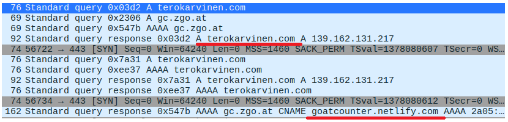 

### i) Oma liikenne
Asetin wiresharkin kuuntelemaan eth0 ja avasin googlen selaimeen.
 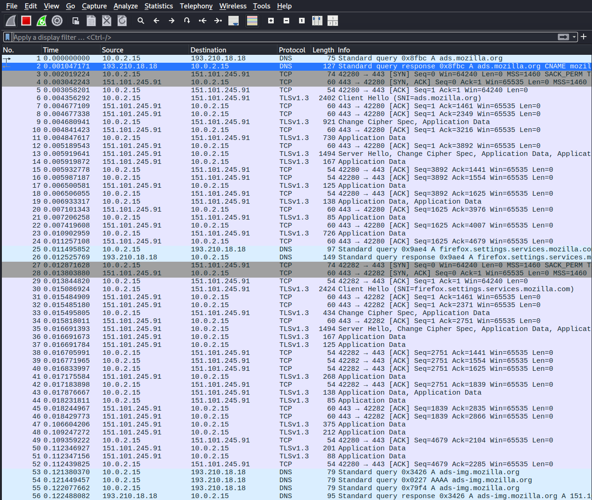 
Liikennettä syntyi 75 paketin verran ja siinä meni noin 0.141s  

Pyrin analysoimaan muutamaa ensimmäistä pakettia.  
 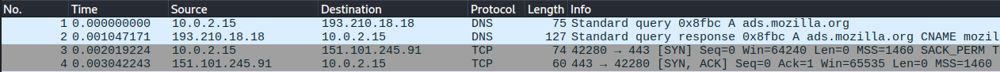 
Ensimmäinen paketti on IP osoitteeseen 193.210.18.18, se on DNS kysely jossa etsitään ads.mozilla.org joka on mozillan mainontaan liittyvä palvelu.

Seuraava paketti on vastaus DNS kyselyyn, jossa DNS palvelin vastaa ads.mozilla.org IP osoitteella.
Sen jälkeen kolmannessa paketissa alkaa TCP handshake eli HTTPS yhteyden muodostaminen.

## Lähteet:
https://terokarvinen.com  
https://chatgpt.com  
https://www.geeksforgeeks.org/linux-unix/ip-command-in-linux-with-examples/