# h3

### x) Lue ja Tiivistä
* SDR (Software-defined radio) eli radio jonka ominaisuuksia, voidaan määrittää ohjelmallisesti.
* rtl_433 on työkalu, jolla voidaan purkaa kaapattuja signaaleja.
* URH (Ultimate Radio Hacker) on työkalu, jolla voidaan tallentaa, analysoida, muokata ja uudelleenlähettää mitä tahansa signaaleja.

### b) rtl_433
Tehtävässä tuli asentaa ja ajaa rtl_433 ohjelma.
Latasin ohjelman komennolla:
 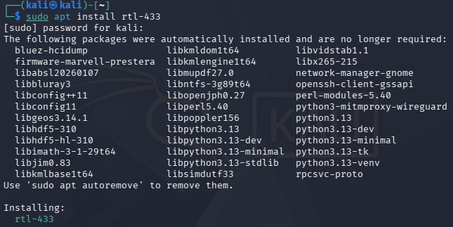 
Kun yritin ajaa ohjelman se ilmoitti ettei sdr laitetta ole saatavilla.
 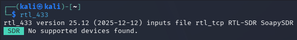 
Latasin seuraavassa tehtävässä käytettävän tiedoston ja kokeilin avata sen ohjelmassa
 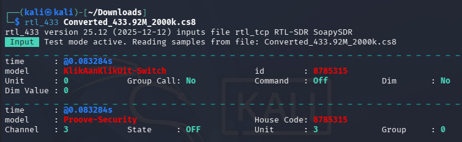 

### c) Automaattinen analyysi
 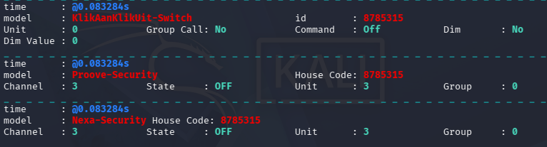 
Ajattelin aluksi että tässä kaappauksessa olisi 3 eri laitetta, mutta signaalit on kaapattu täysin samaan aikaan ja kahden sisältö on identtinen ja kolmannen sisältö näyttää jokseenkin samalta.
* Id ja house code ovat 8785315
* Command / State ovat OFF

rtl_433 purkaa kaapattuja signaaleja sen valmiilla protokollilla ja näyttää paketit mikäli jokin niistä tuottaa järkevää sisältöä. 

Vaikuttaa hieman siltä että jokin laite lähettää signaalia, jonka on tarkoitus sammuttaa vastaanottava laite ja sillä on lähetetty 4 kertaa.

Googletin paketeissa esiintyvät modelit ja selvisi että ne ovat erilaisia älykoti tuote valmistajia.

### d) Too complex 16?
 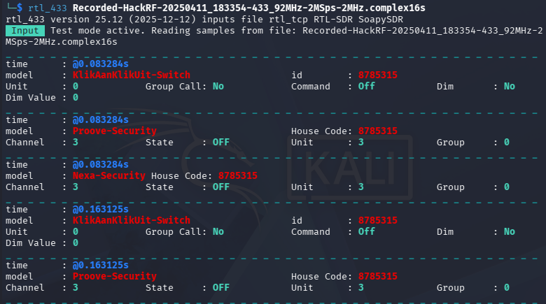 
Syötin tehtävän annossa olleen tiedoston suoraan rtl_433 ja se näyttää olevan täysin sama tiedosto kuin aikaisemmassa tehtävässä.

### e) Ultimate Radio Hacker
 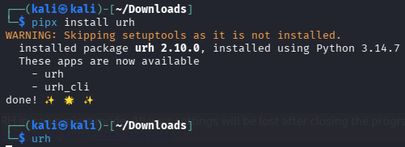 
apt ei löytänyt urh ohjelmaa, joten asensin sen pipx kautta.
 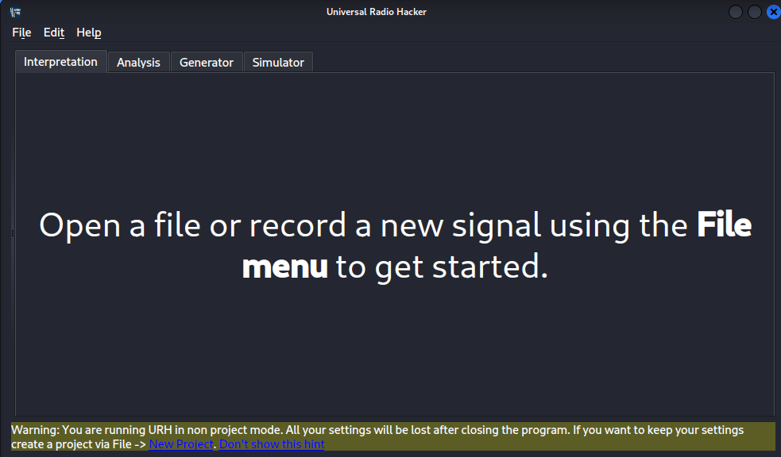 

Ensimmäisenä loin uuden projektin:
 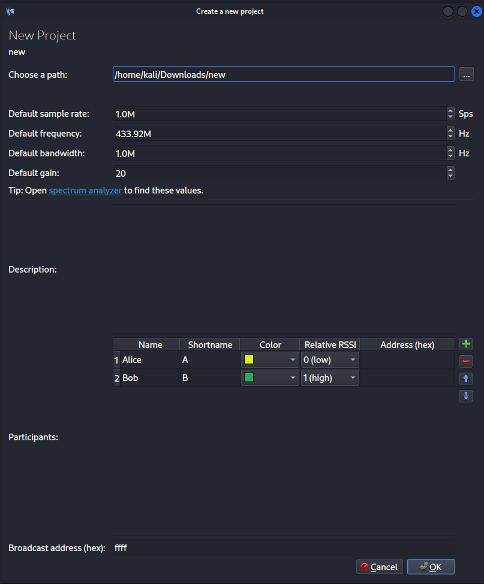 

Sitten importoin tiedoston:
 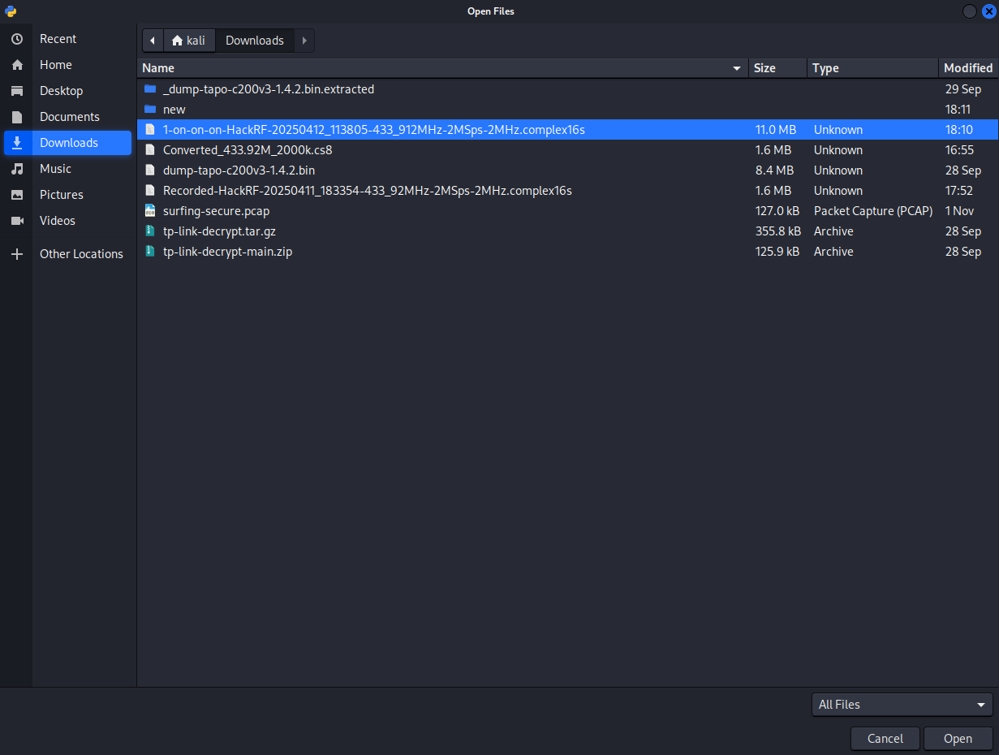 
 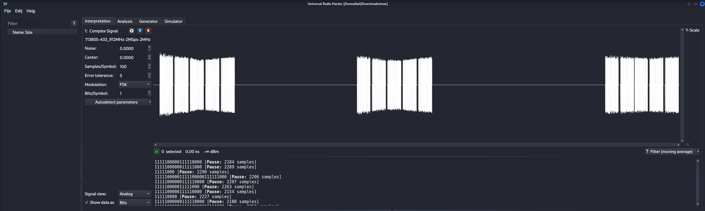 

### f) Yleiskuva
 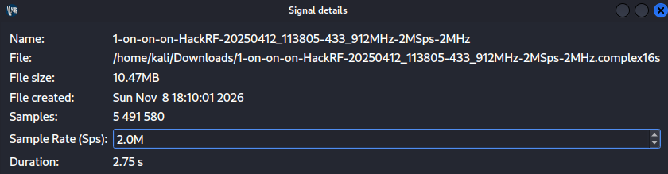 
Suurin osa tiedoista tulee tiedoston nimestä ja tiedoston nimeä on voitu muokata:
* Koko kaappauksen kesto on 2.75s
* Nimestä voitaisiin päätellä että se on nauhoitettu 12.4.2025, file created näyttää olevan se päivä kun tiedosto ladattiin koneelle.
* Taajuus on todennäköisesti noin 433MHz
* Kaikki 3 signaalia näyttävät päällisin puolin samalta pituuden ja ulkonäön osalta.

### g) Bittistä
 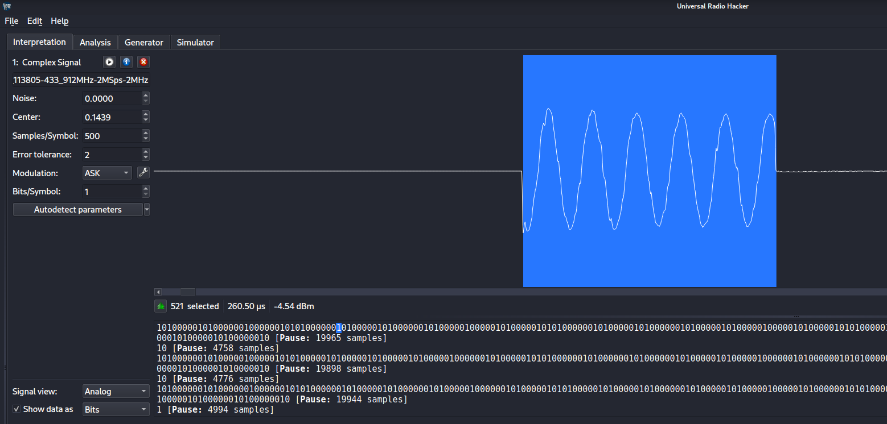 
Valitsin demoduloidusta bittinäkymästä "1" joka vastasi aluetta jolla oli jotakin toimintaa ja sen kesto oli noin 260.50µs

Yhteen silmänräpäykseen (250ms average) mahtuu noin 970 bittiä.

## Lähteet:
https://www.youtube.com/watch?v=sbqMqb6FVMY&t=199s 
https://www.onetransistor.eu/2022/01/decode-433mhz-ask-signal.html 
https://github.karllohner.com/SDR/Decoding/Example_2019-01-24/ 