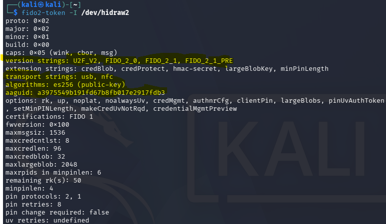
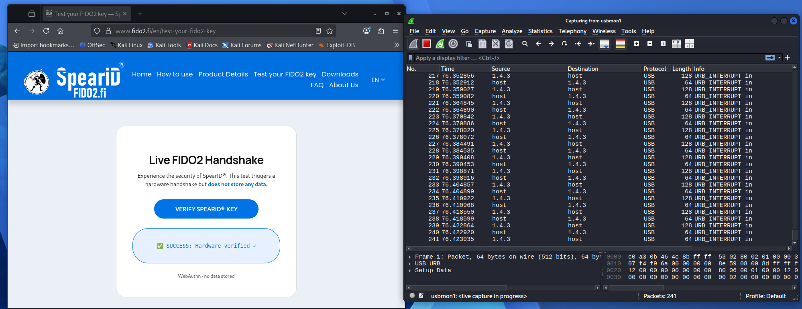

# h4 Alternate assignment: SpearId Fido2 Security Key

### Mikä se on? Mitä se tekee?
USB / NFC laite jota käytetään vahvaan tunnistautumiseen. Sillä voidaan korvata salasana, joka on arvattavissa tai ongittavissa käyttäjältä, fyysisellä avaimella jota kannetaan mukana ja liitetään laitteeseen tarvittaessa.

Se noudattaa FIDO Alliancen ja W3C:n (World Wide Web Consortium) yhteistyössä tuottamaa FIDO2 standardia, joka perustuu sitä edeltävään FIDOn tuottamaan U2F (Universal 2nd Factor) autentikaatio standardiin.

Tämä autentikaattori tarvitsee PIN-koodin toimiakseen. Pelkkä laitteeseen kiinnittäminen ei riitä.

### FIDO 2
Koostuu WebAuthn ja CTAP2 (FIDO Client To Authenticator 2) protokollista, jotka yhdessä määrittävät standardin mukaisen autentikaatio protokollan ja jossa endpointit koostuvat käyttäjän hallitsemasta cryptografisesta autentikaattorista (tässä tapauksessa SpearId Security Key) ja WebAuthn Relying Party, jota kutsutaan myös FIDO2 serveriksi.

WebAuthn protokolla määrittää miten selain ja palvelin vaihtavat haasteen, julkisen avaimen ja allekirjoituksen.

CTAP2 määrittää miten laite ja autentikaattori keskustelevat: tunnistetietojen luominen, haasteen allekijoittaminen ja PIN-koodin tarkistus.

### Tutkiminen
Pyrin tutkimaan tikkua muutamilla eri työkaluilla ja dokumentoimaan sen mitä sain siitä selville. En saanut Security Key:tä luettua ollenkaan mobiililaitteen NFC ominaisuudella. Tutkiminen on suoritettu virtuaalikoneella, jossa käyttöjärjestelmänä Kali.

Pyysin Claude Sonnet 5.5 ohjeita siihen miten tutkia laitetta. Se ohjeisti kokeilemaan fido2-tools nimistä ohjelmaa.

#### fido2 tools:
 

Version strings: U2F_V2, FIDO_2_0, FIDO_2_1, FIDO_2_1_PRE (FIDO protokolla versiot joita security key tukee)

Transport strings: USB, NFC (Tukee USB ja NFC yhteyttä)

Algorithms: es256 (tukee es256 allekirjoitus algoritmia, tämä on pakollinen kaikissa FIDO2 avaimissa) 

AAGUID (Authenticator Attestation Globally Unique Identifier) on 128-bittinen tunniste, joka kertoo autentikaattorin valmistajan ja mallin. Kaikilla saman mallin avaimilla on sama AAGUID. Palvelin voi rekisteröinnin yhteydessä käyttää sitä tarkistaakseen, minkä tyyppisellä autentikaattorilla käyttäjä tunnistautuu, ja sallia tai estää tietyt mallit.

Alempaa kuvasta löytyy muita tietoja kuten:
* fwversion: Firmware version 
* minpinlen: PIN koodin vähimmäis merkki määrä 
* remaining rk(s): kuinka monta resident key (discoverable credential on uudempi termi) laite voi vielä tallentaa 
* pin retries: monestiko pin koodia voi yrittää 

#### Wireshark:
Näillä komennoilla sai usb liitännät näkyviin wiresharkkiin:
Sudo modprobe usbmon 
Sudo wireshark

Valitsemalla usbmon1 wiresharkissa ja luomalla liikennettä esimerkiksi liittämällä tikku tai kokeilemalla spearId Live Fido2 Handshake: 
  
En saanut oikeastaan mitään uutta irti tästä, mutta tulipahan kokeiltua.

### Lähteet:
FIDO Yleiseti:
https://en.wikipedia.org/wiki/FIDO_Alliance 
AAGUID:
https://www.corbado.com/glossary/aaguid 
Claude Sonnet 5.5