# h5

latasin harjoituksen mininet tiedostot one drivesta ja loin uuden mininet VM VirtualBoxiin. Käytin tehtävissä Claude Sonnet 5.5 Mediumia selittämään vieraita käsitteitä ja neuvomaan miten mininetin sai päälle ja toimimaan.

Toisena virtuaalikoneena tässä harjoituksessa on Kali. Tehtävää varten lisäsin molemmille host only network adapterin.
 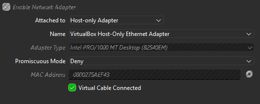 

Avasin molemmat koneet ja kokeilin molemmissa "ip a" komentoa. Kuvassa mininet vm eth1 on DOWN
  

Saadaan se UP tilaan komennoilla
* sudo ip link set eth1 up      (kytkee eth1 liitännän päälle)
* sudo dhclient eth1            (asettaa sille IP osoitteen)

 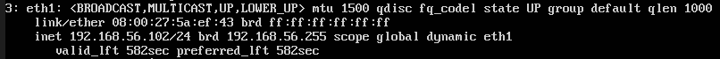 

Varmistetaan että koneet voivat olla yhteydessä toisiinsa host-only networkissa:
 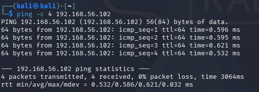 

Muodostetaan ssh yhteys:
 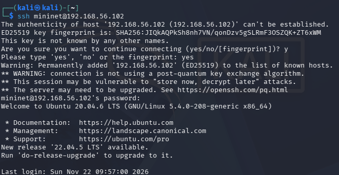 

### a) 
Lähdin käymään tehtävää läpi seuraten kurssi dioja.

Suoritetaan seuraavat komennot:
* ryu-manager ryu.app.simple_switch_13 (ryu ohjelma jää ajoon)
* sudo mn --topo single,3 --mac --switch ovsk --controller remote 

* sudo mn (ajaa mininetin sudo oikeuksilla)
* --topo single,3 (Topologia: 1 kytkin, 3 isäntää (h1, h2 ja h3))
* --mac (antaa isännille omat mac osoitteet)
* --switch ovsk (Kytkintyyppi: Open vSwitch)
* --controller remote (käyttää ulkoista ohjainta (ryu))
 
Kuvassa näkyy mininet käynnissä ja pingall komento suoritettu. Kaikki nodet ovat päällä
 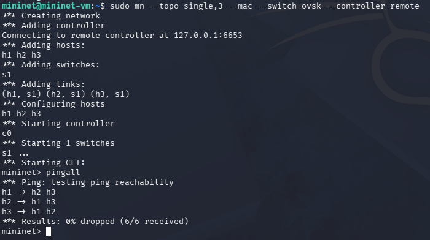 

Mininetissä xterm h1 ei toiminut. "ssh -X" -komento korjasi ensimmäisen ongelman ja toinen ongelma ratkesi asettamalla lisäämällä xauth MIT-MAGIC-COOKIE
 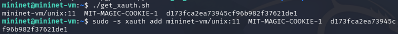 

Seuraavaksi katsottiin arp -n
 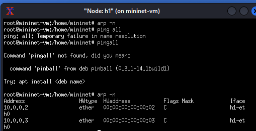 

ARP -n tulostaa arp taulun ilman nimiä.
Esimerkiksi IP 10.0.0.2 löytyy MAC osoitteesta 00:00:00:00:00:02

Sitten käynnistetään
* tcpdump - tallentaa verkkoliikenteen tiedostoon
* wireshark - näyttää liikenteen reaaliajassa graafisessa käyttöliittymässä
* sshesame - ssh honeypot, joka teeskentelee oikeaa ssh palvelinta ja tallentaa kirjautumis yritykset

 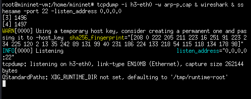 

Tämän jälkeen avasin vielä toisen h3 terminaalin ja ajoin python3 ./arp_poison.py
 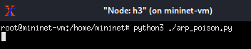 

Sitten yritetään ssh yhteyttä h2
 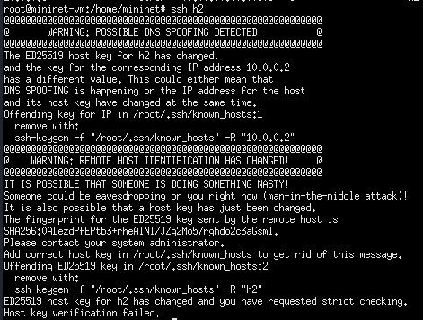 

seurataan ohjeita:
 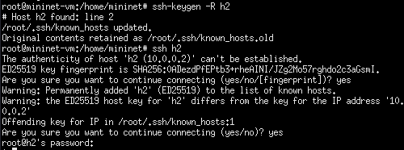 

Ja lopulta tarkastellaan h3 terminaalia
 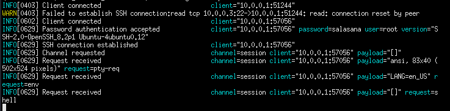 

Tulosteesta voidaan nähdä:  
* password = salasana 
* user = root

Sekä se että ohjelma esittää että kaikki toimi ongelmitta ja normaalisti.

### b) ICMP Spoofing and TCP session hijacking

Navigoin lab/01-Network-Security-Lab/scripts hakemistoon ja ajoin sudo python hub_topo.py, jonka jälkeen avasin h1, h2 ja h3 omat terminaalit.

 Task1 ICMP Spoofing:
Ajoin h1 terminaalissa python scriptin sniff_icmp ja pingasin sitä h2 terminaalista.
 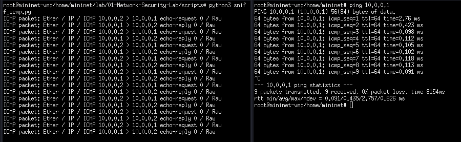 

Mitä se tekee?
* scripti kuuntelee icmp (ping) liikennettä samassa verkossa ja näyttää pakettien tietoja.
* ICMP (Internet Control Message Protocol) spooffauksessa hyökkääjä lähettää paketteja väärennetyllä IP osoitteella.

 Task2 Arp Cache Poisoning (MITM):
Tässä tehtävässä ajettiin upd_server, udp_client ja arp_poison scriptit.
 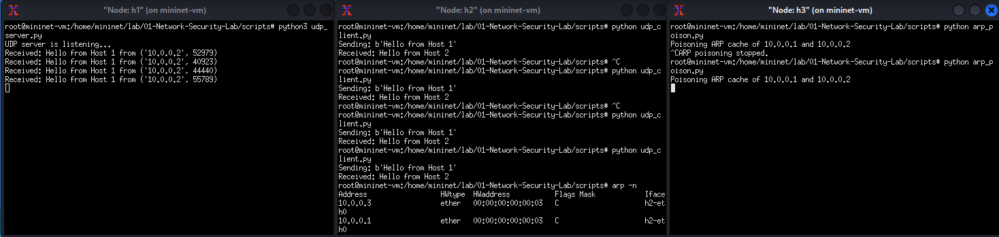 
Tehtäväss arp poisoning reitittää liikenteeen h1 ja h2 välillä h3 kautta. 
arp -n komennon tulosteessa voidaan nähdä että h1 mac osoite on sama kuin h3.
En ole aivan varma olisiko h3 terminaalin kuulunut tulostaa jotakin.

 Task3 TCP Session Hijacking:
Tässä tehtävässä kaapataan TCP yhteys.
Yhdessä h3 terminaalissa ajetaan sniff scriptiä, joka kaappaa tiedot kuten Ip-osoitteet, portit, ja sekvenssinumerot ja tcp_hijack skripti käyttää niitä lähettääkseen väärennettyjä paketteja, jotka näyttävät tulevan h2:lta

 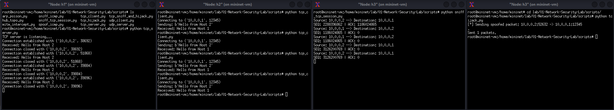 

### c) DDos_simulation
Tässä tehtävässä en saanut ryu:ta toimimaan, joten tapahtumia ei voi tarkastella.
 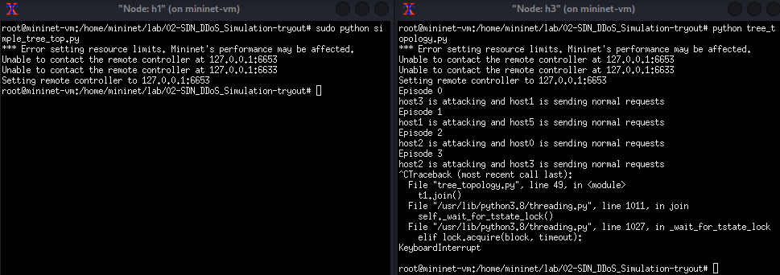 
Tässä kuitenkin skripti ajossa.

### d) Evilginx ja PTunnel-ng
En lähteny asentamaan tai kokeilemaan työkaluja, mutta ajattlin lukea niistä hieman.

 Evilginx on phishing työkalu, joka toimii välityspalvelimena kirjautumissivun ja uhrin välissä. Se välittää liikenteed oikealla sivustolle, mutta kaappaa käyttäjätunnuksen, salasanan sekä evästeet. Evästeet varastamalla se voi ohittaa 2FA sillä se saa valmiin sessio tokenin.

Muita toiminnallisuuksia ovat esimerkiksi phishing linkkien generointi ja Admin paneeli, josta näkee kuka linkkejä on klikannut.

  PTunnel-ng on työkalu jolla voidaan tunneloida TCP-liikennettä ICMP-pakettien sisällä. Sillä voidaan käytännössä piilottaa muuta liikennettä (kuten ssh yhteys) ICMP-liikenteen sisälle ja siten ohittaa suojaukset jotka estävät kaiken muun paitsi ICMP-liikenteen (palomuurin kiertäminen). Toimii ilmeisesti molempiin suuntiin. Liikenne voidaan ilmeisesti myös salata, jolloin sitä ei näe vaikka tarkkailee ICMP liikennettä.

## Lähteet:
https://evilginx.com/ 
https://github.com/utoni/ptunnel-ng 

Tekoäly: Claude Sonnet 5.5 Medium